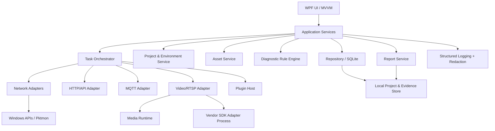
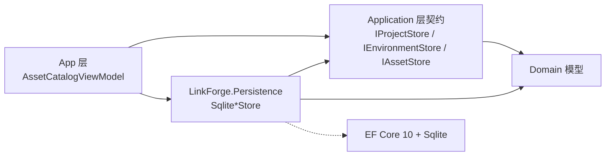
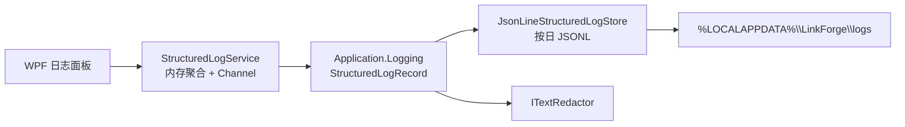
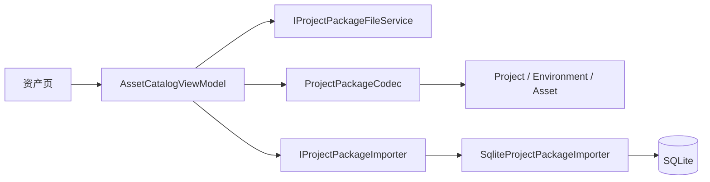

# Windows 技术架构设计

## 1. 推荐方案

- UI/宿主：C#、.NET 10（正式发布前核验目标运行时支持周期）、WPF、MVVM。
- UI 组件：优先使用可维护的主题/控件库，封装统一设计 Token，不把业务逻辑写入控件代码。
- DI/配置：Microsoft.Extensions.DependencyInjection、Options、Logging。
- 持久化：SQLite + EF Core 或轻量数据访问层；项目文件导入导出采用带 schemaVersion 的 JSON 包。
- 网络：HttpClientFactory；DNS/TCP/ICMP 使用 .NET/Windows API；外部工具通过安全的 Process 参数数组调用。
- MQTT：优先评估 Eclipse Paho MQTT C/C++ 或成熟 .NET MQTT 库，基于实际版本、许可证和维护状态选型。
- 视频：标准协议诊断与播放引擎分离；评估 FFmpeg 及其许可证、构建配置和分发要求；厂商 SDK 以插件/独立进程隔离。
- 抓包：优先评估 Windows Pktmon 的受支持工作流；第三方驱动作为可选组件并明确管理员权限、许可与安装体验。
- 日志：结构化日志（如 Serilog 或 Microsoft.Extensions.Logging 生态），敏感字段统一经过 Redaction 层。
- 报告：HTML 模板离线渲染；PDF 作为后续独立能力。
- 测试：xUnit/NUnit、集成测试、协议模拟器、固定样例和人工验收脚本。

> 具体依赖版本、许可证、支持矩阵和安全公告必须在实施阶段核验并锁定，不把本文件中的技术候选视为永久选型结论。

## 2. 分层架构



## 3. 核心架构决策

### 3.1 UI 不直接执行 I/O
所有网络、文件、媒体和外部进程操作通过异步 Application Service 执行。UI 只订阅任务状态与结果；所有长任务支持取消令牌。

### 3.2 统一任务模型
```csharp
public enum DiagnosticStatus
{
    Passed, Failed, Warning, Skipped, Unknown, Cancelled, TimedOut
}

public sealed record DiagnosticStepResult(
    string StepId,
    string Name,
    DiagnosticStatus Status,
    DateTimeOffset StartedAt,
    TimeSpan Duration,
    string Summary,
    IReadOnlyDictionary<string, string>? SafeEvidence = null);

public sealed record DiagnosticRunResult(
    string RunId,
    string ProjectId,
    string TargetId,
    string Kind,
    DiagnosticStatus Status,
    DateTimeOffset StartedAt,
    DateTimeOffset? EndedAt,
    IReadOnlyList<DiagnosticStepResult> Steps);
```
状态模型要避免把“未执行/无法判断”折叠成失败；证据必须经过脱敏后才能写入日志和报告。

### 3.3 插件契约
插件首期建议是进程内、受控且版本化的 .NET 接口；涉及不稳定原生 SDK、驱动或不可信第三方模块时使用独立进程。禁止任意插件直接访问宿主凭据库。

建议接口概念：
```csharp
public interface IDiagnosticAdapter
{
    string Id { get; }
    string DisplayName { get; }
    Version ApiVersion { get; }
    IReadOnlyCollection<string> Capabilities { get; }
    Task<DiagnosticRunResult> ExecuteAsync(
        DiagnosticRequest request,
        IProgress<DiagnosticProgress> progress,
        CancellationToken cancellationToken);
}
```
插件清单包含 ID、版本、API 版本、发布者、能力声明、文件哈希/签名状态、依赖和权限提示。

### 3.4 凭据与配置
- 非秘密配置写入项目数据库/JSON。
- 密码、Token、客户端私钥等只存秘密引用；秘密通过 Windows DPAPI 或 Credential Manager 保护。
- 导出项目时默认不包含秘密；用户显式选择也要二次确认。
- URL 中的用户名/密码在 UI、日志、错误消息、报告中统一遮蔽。
- 日志脱敏不能仅靠 UI 层，必须在日志写入前处理。

### 3.5 外部进程
- 不通过 `cmd.exe /c` 拼接用户输入。
- 使用 `ProcessStartInfo.ArgumentList` 或等价参数数组。
- 固定可执行文件路径、验证参数、限定超时、捕获退出码和标准输出/错误。
- 不把密码放进命令行参数，避免进程列表泄露。
- 记录工具版本和命令模板，但对敏感参数脱敏。

## 4. 建议解决方案结构

```text
src/
  LinkForge.App/                 # WPF 宿主、导航、主题、DI
  LinkForge.Application/          # 用例、任务编排、DTO、接口
  LinkForge.Domain/               # 项目、资产、任务、状态、规则模型
  LinkForge.Infrastructure/       # SQLite、日志、凭据、文件存储
  LinkForge.Adapters.Network/     # Ping/TCP/DNS/Traceroute
  LinkForge.Adapters.Http/        # HTTP/API 请求
  LinkForge.Adapters.Mqtt/        # MQTT 客户端
  LinkForge.Adapters.Video/       # RTSP/ONVIF/媒体抽象
  LinkForge.Reporting/            # HTML 报告模板与脱敏
  LinkForge.Plugin.Abstractions/  # 插件契约与版本
tests/
  LinkForge.Domain.Tests/
  LinkForge.Application.Tests/
  LinkForge.Adapters.Tests/
  LinkForge.IntegrationTests/
docs/
  PRD.md
  FUNCTION_TREE.md
  ARCHITECTURE.md
  UI_WIREFRAMES.md
  CODEX_TASKS.md
```

### 4.1 网络适配器依赖边（阶段 05）

网络基础诊断采用 `App → Adapters.Network → Domain / Plugin.Abstractions`：

- `LinkForge.Adapters.Network` 只实现 `INetworkProbe` 与
  `NetworkDiagnosticAdapter`，不引用 App，也不持有 UI 状态。
- `LinkForge.App` 负责注入 `WindowsNetworkProbe`、适配器、结果导出器和
  `NetworkDiagnosticsViewModel`。
- 超时、取消、异常映射、状态聚合与脱敏仍由
  `LinkForge.Application.Diagnostics.DiagnosticTaskRunner` 统一执行。

因此网络页可以独立测试系统边界（Ping/TCP/DNS/本机网络/tracert），
而 UI 不直接持有 `System.Net.NetworkInformation` 或 `Process`。

### 4.2 HTTP/API 适配器依赖边（阶段 05）

HTTP/API 工作台采用 `App → Adapters.Http`，且 `Adapters.Http` 不引用
App、Application 或 WPF：

- `HttpApiTransport` 封装 `SocketsHttpHandler` 与 `HttpClient`，
  页面和视图模型不得直接创建 HTTP 客户端。
- 传输层只表达“请求是否完成、是否收到响应、失败属于 DNS/连接/TLS/超时/非法请求”；
  历史、复制、导出和日志由 App 层统一脱敏。
- `HttpApiResponse` 对 4xx/5xx 正常返回；只有传输异常才抛出
  `HttpApiTransportException`，避免把“服务器返回 404”误报为网络故障。
- 响应按字节上限读取并截断；TLS 证书验证始终启用，不提供绕过开关。
- 本地 `HttpListener` 集成测试覆盖真实 socket/HTTP 路径，不依赖公网。

### 4.3 MQTT 适配器依赖边（阶段 05）

MQTT 基础调试器采用 `App → Adapters.Mqtt`，且 `Adapters.Mqtt` 不引用
App、Application 或 WPF：

- `MqttTransport` 封装 MQTTnet 客户端，只表达连接、断开、订阅、发布、
  消息流和连接状态事件；不写历史、不做 UI、不做导出。
- 页面与视图模型只依赖 `IMqttTransport`，MQTTnet 具体类型不泄漏到 WPF。
- TLS 证书验证始终启用；用户名/口令不写入日志、订阅列表、复制与导出。
- Topic 与载荷构造为领域对象时即脱敏，降低后续复制/导出泄露风险。
- 集成测试使用本地进程内 Broker，不依赖 Docker 或公网。


### 4.4 RTSP 适配器依赖边（阶段 05）

RTSP 分阶段信令诊断采用 `App → Adapters.Video`，且 `Adapters.Video` 不引用
App、Application 或 WPF：

- `RtspDiagnosticAdapter` 封装 DNS、TCP、RTSP OPTIONS/DESCRIBE、SDP 解析；
  只表达分阶段诊断结果，不写历史、不做 UI、不做导出。
- 页面与视图模型只依赖 `IRtspProbe`，适配器内部类型不泄漏到 WPF。
- userinfo 仅用于 Basic 认证；请求行不携带 userinfo；401 后按 `WWW-Authenticate` 判断。
- 当前仅支持 Basic 重试，Digest 明确失败，不伪造成功。
- RTP、SETUP/PLAY、解码、首帧未执行，明确标记 `Skipped`。
- RTSP URL 密码在显示、日志、事实、复制与导出中统一脱敏。
- 集成测试使用本地 `LocalRtspServer`，真实 TCP 和 RTSP 报文，不依赖公网。

### 4.5 报告服务依赖边（阶段 05）

离线 HTML 报告采用 `App → Reporting → Application / Domain`，
且 `Reporting` 不引用 App、适配器或任何 WPF 程序集：

- `ReportGenerator` 负责“生成前扫描 → 渲染 → 原子写入”，
  `ReportHtmlRenderer` 是唯一模板与唯一编码点，不引入模板引擎。
- `ReportPageViewModel` 只读取 `IRunHistoryStore` 的真实任务历史，
  不重构、不补齐、不改写结论；没有历史就显示空状态。
- 保存对话框与资源管理器定位通过 `IReportFileExporter` 隔离，
  视图模型可在无 UI 的测试宿主中验证取消、失败与成功路径。
- 报告文件为 UTF-8 无 BOM 的自包含 HTML，不含脚本、外链样式、
  远程字体或图片，可在断网现场直接打开。
- 报告生成前必须通过独立的敏感信息扫描；命中时不写文件，
  包括不留下临时文件。

### 4.6 开发者工具依赖边（阶段 05）

通用开发者工具采用 `App → DeveloperTools`，且 `DeveloperTools` 为零依赖的
`net10.0` 纯库，不引用 App、Application、WPF 或任何适配器：

- `DeveloperTransforms` 只做确定性的离线文本/时间转换：JSON、URL、Base64、
  Unix 时间戳、UUID 与 JWT 载荷解码；不访问网络、文件、日志或剪贴板。
- 输入按 UTF-8 字节预检，上限 1 MiB；非法 UTF-16 代理对、非法百分号序列、
  非法 Base64、无效 JSON/JWT 返回结构化可读失败，不抛到 UI。
- JWT 仅解码，不验证签名、有效期或签发者；界面必须明确标注该边界，
  不得把“可解码”表述为“令牌可信”。
- `DeveloperTransformExecutor` 通过 `Task.Run` 执行转换并支持取消；
  `IDeveloperResultClipboard` 隔离剪贴板，便于无 UI 测试。
- 转换结果不写日志、历史或报告；若后续增加持久化，必须先接入统一脱敏。

### 4.7 插件宿主依赖边（阶段 05）

插件清单校验与进程外执行采用
`App → Plugin.Hosting → Domain / Plugin.Abstractions`：

- `PluginCatalogScanner` 只扫描插件目录并校验清单、API 版本、架构、
  入口相对路径、重解析点与 SHA-256；不加载插件程序集。
- `OutOfProcessDiagnosticAdapter` 通过 `ProcessStartInfo.ArgumentList`
  启动独立进程，使用单行 JSON 协议完成 `hello` 握手与 `executeStep`；
  崩溃、超时、协议错误和取消分别映射，不向宿主冒泡未处理异常。
- 插件宿主不引用 App、Application 或 WPF，也不提供宿主秘密库入口；
  参数按清单声明的白名单下发，插件返回文本在宿主出口再次脱敏。
- 签名枚举只有 `Unsigned` 与 `DeclaredSignedUnverified`；
  清单声明不等于证书链验证，界面不得显示“签名已验证”。
- `Plugin.Hosting` 为零 NuGet 依赖的 `net10.0` 纯库；
  插件目录、信任确认、运行编排、复制与导出由 App 层负责。

### 4.8 持久化依赖边（阶段 05）

项目、环境与资产存储采用
`App → Persistence → Application / Domain`：



- **契约在 Application，实现在 Persistence**：
  视图模型依赖的是"能力"（`IProjectStore` 等），换存储实现（SQLite → 其它）
  不应改动任何调用方。这与 `IRunHistoryStore` 的处理一致。
- **每次操作新建 DbContext**：DbContext 不是线程安全的，
  而诊断任务与界面会并发读写存储。共用一个长生命周期上下文会出现
  "另一个线程正在使用此上下文"这类只在现场偶发的中断。
- **不用 `AddDbContext` / `IDbContextFactory`**：把 DI 容器的生命周期语义引进持久化层，
  会让"这个存储什么时候释放"取决于容器注册方式。这里由视图模型持有工厂、用完即释放。
- **结构升级走 EF Core 迁移**，不手工改表；`Domain` 与 `Application` 都不依赖 EF Core。
- **`Persistence` 不引用 App / WPF / 任何适配器**：适配器是诊断能力的实现，
  持久化是资产数据的存储；两者耦合后"读一个项目"会拉进 RTSP/MQTT/HTTP 依赖。
- **凭据只存引用键**：`Project`、`EnvironmentProfile`、`Asset` 三个领域模型
  都不含任何秘密字段，因此"项目数据里没有明文密码"是结构保证（ADR-008），
  而不是靠导出代码记得过滤。

### 4.9 结构化日志依赖边（阶段 05）

应用日志采用 `App → Application.Logging → Application.Diagnostics`：



- `LogEntry` 在构造时脱敏；JSONL 存储写入前与读取时再次脱敏，
  UI、磁盘、复制、导出和报告共用同一套敏感信息规则。
- 日志写入通过后台 Channel 串行执行，不阻塞 UI；关闭前有限等待 flush。
- 每日文件为 `linkforge-yyyyMMdd.jsonl`，当前日最近 5000 条进入日志面板；
  单行损坏被跳过，存储读写失败以独立 `StorageError` 呈现。
- 筛选、复制与导出都只作用于当前可见日志；取消导出与失败分别表达。
- 不引入 Serilog；日志文件不加密，且尚未实现轮转保留、归档和签名校验。

### 4.10 ONVIF 适配器依赖边（阶段 05）

ONVIF 标准接入采用 `App → Adapters.Onvif → Domain / Plugin.Abstractions`，
且 `Adapters.Onvif` 不引用 App、Application 或 WPF：

- `OnvifDiagnosticAdapter` 封装 WS-Discovery、设备信息、能力、媒体 Profile 与
  Stream URI 查询；只返回诊断阶段结果，不写历史、不做 UI、不做导出。
- 发现使用 UDP `239.255.255.250:3702`，单条损坏组播包被隔离，
  不中断发现窗口，也不进入原始输出。
- SOAP 请求始终经过 HTTP/HTTPS 与 TLS 证书校验；不提供关闭证书校验的开关，
  不执行自动网段扫描。
- 当前只实现 WS-Security UsernameToken；凭据仅用于构造请求，
  在显示、日志、事实、复制与 JSON 导出中统一脱敏。
- 响应限制为 2 MiB，禁止 DTD，并限制 XML 解析深度与实体扩展。
- 未发现设备保持 `Unknown`，不等同于“网络中没有 ONVIF 设备”。
- Stream URI 可用只证明标准信令返回了播放地址，不证明 RTP 已接收、
  媒体已解码或首帧已显示；PTZ、事件、录像、厂商 SDK 与 GB/T 28181 未实现。
- 集成测试使用本地 HTTP 设备服务与受控组播报文，不依赖公网或真实设备。

### 4.11 项目包依赖边（阶段 05）

项目包导入导出采用
`App → Application.Projects / Persistence`，且项目包契约不引用 WPF：



- `ProjectPackageCodec` 只处理严格、版本化的非秘密 JSON；格式错误转换为
  可展示的 `ProjectPackageFormatException`。
- `IProjectPackageImporter` 契约在 Application，SQLite 实现在 Persistence；
  导入器使用单事务并默认拒绝覆盖。
- 文件对话框和字节读写属于 App；页面与其他业务逻辑不直接处理文件路径。
- 导入导出通过异步命令执行，提供取消入口；项目包、CSV 和存储写操作互斥。


## 5. 关键领域模型
- Project：项目元数据与 SchemaVersion。
- EnvironmentProfile：环境变量、代理引用、超时策略。
- Asset：目标、协议、厂商、标签、备注。
- SecretReference：秘密存储提供方和引用 ID，不保存明文。
- DiagnosticRun / DiagnosticStep：统一任务与步骤结果。
- EvidenceArtifact：证据文件路径、哈希、大小、脱敏状态和 MIME 类型。
- LogEntry：时间、级别、RunId、模块、消息和脱敏属性。
- PluginManifest：插件身份、版本、能力、哈希/签名状态。
- ReportArtifact：报告类型、生成时间、关联 RunId、文件哈希。

## 6. 错误处理与可观测性
- 每个适配器返回统一状态、用户可读摘要和内部错误分类。
- 用户界面不展示原始堆栈作为唯一反馈；提供“展开技术详情”。
- 日志字段至少包含 Timestamp、Level、Module、RunId、TargetId、EventId。
- 诊断证据与日志通过 RunId/StepId 关联。
- 任务失败不能阻断其他独立步骤，除非后续步骤依赖失败步骤。
- 外部组件崩溃要被隔离并转换为明确错误。

## 7. 安全威胁模型
资产：设备凭据、API Token、抓包、项目配置、诊断报告、插件和更新包。  
威胁：凭据泄漏、恶意插件、命令注入、未经授权扫描、报告泄露、依赖供应链风险、原生 SDK 崩溃。  
控制：秘密分离、脱敏、授权范围确认、速率限制、签名/哈希校验、最小权限、进程隔离、依赖清单、可审计日志。

## 8. 发布与交付
- V1.0 发布物是未签名的双架构 Inno Setup 用户级安装器，以及
  `win-x64` / `win-x86` 自包含便携 ZIP。
- `Directory.Build.props` 统一版本、产品、公司、仓库与确定性构建元数据；
  程序集信息版本附带 Git 提交号。
- `scripts/publish.ps1` 默认执行 Release 全量构建/测试，再发布到 `artifacts/`，
  生成 `release.json`、`VERSION.txt`、依赖/许可证清单、CycloneDX SBOM、
  包内 `SHA256SUMS.txt` 与 ZIP 的 SHA-256。
- 工作区不干净时脚本默认拒绝发布；`-AllowDirty` 只用于本地诊断包，
  产物文件名与元数据会带 `.dirty`。
- `scripts/verify-clean-checkout.ps1` 将已提交 `HEAD` 克隆到临时目录，
  重新还原、构建和测试，避免本机 `bin/obj` 掩盖缺失引用。
- 安装器由单一 AppId 管理，默认安装到
  `%LOCALAPPDATA%\Programs\LinkForge`，不要求管理员权限；同时嵌入两套
  自包含载荷，并按安装环境选择架构。
- 卸载保留 `%LOCALAPPDATA%\LinkForge` 用户数据；重复安装覆盖程序文件，
  但没有自动回滚或自动更新。
- 支持矩阵：已实测 Windows 11 10.0.26300 x64 安装链路，以及 x86 自包含载荷
  在 WOW64 下的启动/关闭；Windows 10 真机与 32 位 Windows 安装器选择流程
  仍未完成实测。
- 代码签名、时间戳与 SmartScreen 尚未配置；About 页只展示本机 Authenticode
  信任结果，不能据此宣称供应链审计或发布者信誉已完成。
