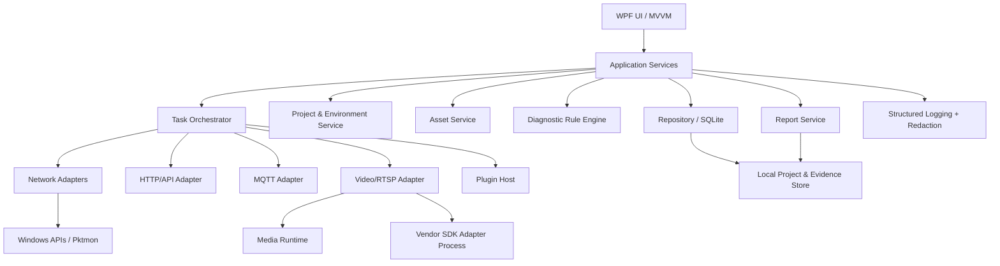

# Windows 技术架构设计

## 1. 推荐方案

- UI/宿主：C#、.NET 10（正式发布前核验目标运行时支持周期）、WPF、MVVM。
- UI 组件：优先使用可维护的主题/控件库，封装统一设计 Token，不把业务逻辑写入控件代码。
- DI/配置：Microsoft.Extensions.DependencyInjection、Options、Logging。
- 持久化：SQLite + EF Core 或轻量数据访问层；项目文件导入导出采用带 schemaVersion 的 JSON 包。
- 网络：HttpClientFactory；DNS/TCP/ICMP 使用 .NET/Windows API；外部工具通过安全的 Process 参数数组调用。
- MQTT：优先评估 Eclipse Paho MQTT C/C++ 或成熟 .NET MQTT 库，基于实际版本、许可证和维护状态选型。
- 视频：标准协议诊断与播放引擎分离；评估 FFmpeg 及其许可证、构建配置和分发要求；厂商 SDK 以插件/独立进程隔离。
- 抓包：优先评估 Windows Pktmon 的受支持工作流；第三方驱动作为可选组件并明确管理员权限、许可与安装体验。
- 日志：结构化日志（如 Serilog 或 Microsoft.Extensions.Logging 生态），敏感字段统一经过 Redaction 层。
- 报告：HTML 模板离线渲染；PDF 作为后续独立能力。
- 测试：xUnit/NUnit、集成测试、协议模拟器、固定样例和人工验收脚本。

> 具体依赖版本、许可证、支持矩阵和安全公告必须在实施阶段核验并锁定，不把本文件中的技术候选视为永久选型结论。

## 2. 分层架构



## 3. 核心架构决策

### 3.1 UI 不直接执行 I/O
所有网络、文件、媒体和外部进程操作通过异步 Application Service 执行。UI 只订阅任务状态与结果；所有长任务支持取消令牌。

### 3.2 统一任务模型
```csharp
public enum DiagnosticStatus
{
    Passed, Failed, Warning, Skipped, Unknown, Cancelled, TimedOut
}

public sealed record DiagnosticStepResult(
    string StepId,
    string Name,
    DiagnosticStatus Status,
    DateTimeOffset StartedAt,
    TimeSpan Duration,
    string Summary,
    IReadOnlyDictionary<string, string>? SafeEvidence = null);

public sealed record DiagnosticRunResult(
    string RunId,
    string ProjectId,
    string TargetId,
    string Kind,
    DiagnosticStatus Status,
    DateTimeOffset StartedAt,
    DateTimeOffset? EndedAt,
    IReadOnlyList<DiagnosticStepResult> Steps);
```
状态模型要避免把“未执行/无法判断”折叠成失败；证据必须经过脱敏后才能写入日志和报告。

### 3.3 插件契约
插件首期建议是进程内、受控且版本化的 .NET 接口；涉及不稳定原生 SDK、驱动或不可信第三方模块时使用独立进程。禁止任意插件直接访问宿主凭据库。

建议接口概念：
```csharp
public interface IDiagnosticAdapter
{
    string Id { get; }
    string DisplayName { get; }
    Version ApiVersion { get; }
    IReadOnlyCollection<string> Capabilities { get; }
    Task<DiagnosticRunResult> ExecuteAsync(
        DiagnosticRequest request,
        IProgress<DiagnosticProgress> progress,
        CancellationToken cancellationToken);
}
```
插件清单包含 ID、版本、API 版本、发布者、能力声明、文件哈希/签名状态、依赖和权限提示。

### 3.4 凭据与配置
- 非秘密配置写入项目数据库/JSON。
- 密码、Token、客户端私钥等只存秘密引用；秘密通过 Windows DPAPI 或 Credential Manager 保护。
- 导出项目时默认不包含秘密；用户显式选择也要二次确认。
- URL 中的用户名/密码在 UI、日志、错误消息、报告中统一遮蔽。
- 日志脱敏不能仅靠 UI 层，必须在日志写入前处理。

### 3.5 外部进程
- 不通过 `cmd.exe /c` 拼接用户输入。
- 使用 `ProcessStartInfo.ArgumentList` 或等价参数数组。
- 固定可执行文件路径、验证参数、限定超时、捕获退出码和标准输出/错误。
- 不把密码放进命令行参数，避免进程列表泄露。
- 记录工具版本和命令模板，但对敏感参数脱敏。

## 4. 建议解决方案结构

```text
src/
  LinkForge.App/                 # WPF 宿主、导航、主题、DI
  LinkForge.Application/          # 用例、任务编排、DTO、接口
  LinkForge.Domain/               # 项目、资产、任务、状态、规则模型
  LinkForge.Infrastructure/       # SQLite、日志、凭据、文件存储
  LinkForge.Adapters.Network/     # Ping/TCP/DNS/Traceroute
  LinkForge.Adapters.Http/        # HTTP/API 请求
  LinkForge.Adapters.Mqtt/        # MQTT 客户端
  LinkForge.Adapters.Video/       # RTSP/ONVIF/媒体抽象
  LinkForge.Reporting/            # HTML 报告模板与脱敏
  LinkForge.Plugin.Abstractions/  # 插件契约与版本
tests/
  LinkForge.Domain.Tests/
  LinkForge.Application.Tests/
  LinkForge.Adapters.Tests/
  LinkForge.IntegrationTests/
docs/
  PRD.md
  FUNCTION_TREE.md
  ARCHITECTURE.md
  UI_WIREFRAMES.md
  CODEX_TASKS.md
```

### 4.1 网络适配器依赖边（阶段 05）

网络基础诊断采用 `App → Adapters.Network → Domain / Plugin.Abstractions`：

- `LinkForge.Adapters.Network` 只实现 `INetworkProbe` 与
  `NetworkDiagnosticAdapter`，不引用 App，也不持有 UI 状态。
- `LinkForge.App` 负责注入 `WindowsNetworkProbe`、适配器、结果导出器和
  `NetworkDiagnosticsViewModel`。
- 超时、取消、异常映射、状态聚合与脱敏仍由
  `LinkForge.Application.Diagnostics.DiagnosticTaskRunner` 统一执行。

因此网络页可以独立测试系统边界（Ping/TCP/DNS/本机网络/tracert），
而 UI 不直接持有 `System.Net.NetworkInformation` 或 `Process`。

### 4.2 HTTP/API 适配器依赖边（阶段 05）

HTTP/API 工作台采用 `App → Adapters.Http`，且 `Adapters.Http` 不引用
App、Application 或 WPF：

- `HttpApiTransport` 封装 `SocketsHttpHandler` 与 `HttpClient`，
  页面和视图模型不得直接创建 HTTP 客户端。
- 传输层只表达“请求是否完成、是否收到响应、失败属于 DNS/连接/TLS/超时/非法请求”；
  历史、复制、导出和日志由 App 层统一脱敏。
- `HttpApiResponse` 对 4xx/5xx 正常返回；只有传输异常才抛出
  `HttpApiTransportException`，避免把“服务器返回 404”误报为网络故障。
- 响应按字节上限读取并截断；TLS 证书验证始终启用，不提供绕过开关。
- 本地 `HttpListener` 集成测试覆盖真实 socket/HTTP 路径，不依赖公网。

## 5. 关键领域模型
- Project：项目元数据与 SchemaVersion。
- EnvironmentProfile：环境变量、代理引用、超时策略。
- Asset：目标、协议、厂商、标签、备注。
- SecretReference：秘密存储提供方和引用 ID，不保存明文。
- DiagnosticRun / DiagnosticStep：统一任务与步骤结果。
- EvidenceArtifact：证据文件路径、哈希、大小、脱敏状态和 MIME 类型。
- LogEntry：时间、级别、RunId、模块、消息和脱敏属性。
- PluginManifest：插件身份、版本、能力、哈希/签名状态。
- ReportArtifact：报告类型、生成时间、关联 RunId、文件哈希。

## 6. 错误处理与可观测性
- 每个适配器返回统一状态、用户可读摘要和内部错误分类。
- 用户界面不展示原始堆栈作为唯一反馈；提供“展开技术详情”。
- 日志字段至少包含 Timestamp、Level、Module、RunId、TargetId、EventId。
- 诊断证据与日志通过 RunId/StepId 关联。
- 任务失败不能阻断其他独立步骤，除非后续步骤依赖失败步骤。
- 外部组件崩溃要被隔离并转换为明确错误。

## 7. 安全威胁模型
资产：设备凭据、API Token、抓包、项目配置、诊断报告、插件和更新包。  
威胁：凭据泄漏、恶意插件、命令注入、未经授权扫描、报告泄露、依赖供应链风险、原生 SDK 崩溃。  
控制：秘密分离、脱敏、授权范围确认、速率限制、签名/哈希校验、最小权限、进程隔离、依赖清单、可审计日志。

## 8. 发布与交付
- CI：格式检查、静态分析、单元测试、集成测试、依赖/许可证扫描。
- 发布：版本号、签名安装包、依赖清单、变更日志、校验和。
- 更新：签名验证、失败回滚、可关闭自动更新。
- 安装：明确是否需要管理员权限；核心 MVP 尽量不要求常驻驱动。
- 支持矩阵：记录 Windows 版本、CPU 架构、SDK 位数、运行库和外部组件版本。
